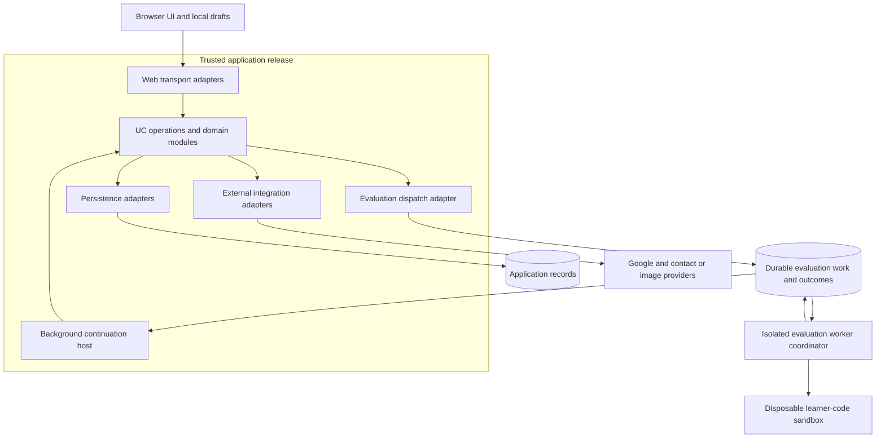
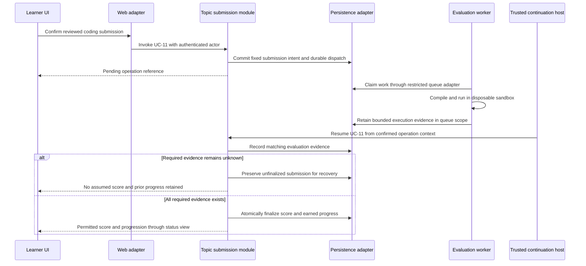

# MasterCangjie Architecture

## Status and related documents

**Accepted architecture shape:** Option A — modular monolith plus an isolated evaluation worker, confirmed on 2026-11-01. [ADR-0001](adr/0001-modular-monolith-isolated-evaluation-worker.md) records that decision and its trade-off.

This document records the module structure and responsibility rules from the accepted design. The [MVP technology stack](mvp-stack.md) was also accepted on 2026-11-01. Implement a clean, functional UI using the existing UX architecture; full visual design, visual polish, and a design system are deferred. No application code, dependencies, infrastructure, or database schema has been created.

Product behavior comes from [product.md](product.md), operations from [use-cases.md](use-cases.md), business decisions from [domain-model.md](domain-model.md), and terminology from [GLOSSARY.md](../GLOSSARY.md). Architecture must preserve those rules rather than redefine them.

The [risk register](risk-register.md) tracks unproven assumptions, required implementation evidence, and the first complete coding-path milestone.

## 1. Structural decision

Keep the trusted business modules in one application release. Keep code evaluation outside the trusted application host, in a separate execution environment. The evaluator reports execution evidence; the trusted application owns result interpretation, scoring, submission finalization, and earned progress.

The monolith can have a web process and a background continuation process built from the same release and business modules. They are runtime hosts for one application, not independently owned or independently versioned business deployments. A long-running compiler job must not require an open browser connection or a long database transaction.



Application records and evaluation queues may share a PostgreSQL installation under the accepted stack, but they have separate access scopes. The learner-code sandbox has no database or queue access. The trusted worker coordinator's limited queue access is not permission to read learner accounts or mutate scores.

## 2. Business modules and ownership

Use deep modules organized around coherent business behavior, not one module per entity, screen, or use case. Each module can contain domain decisions, UC orchestration, and focused adapters. A new pass-through file or generic interface needs a concrete purpose.

| Module | Owns | Does not own | UC references |
| --- | --- | --- | --- |
| Roadmap | Ordered categories and topics, lessons, assessment definitions, published assessment revisions, content readiness and correction | Learner scores, topic completion, execution | UC-04–UC-06, UC-23–UC-24 |
| Topic submission | Evaluation-attempt state, applicability of results, problem and topic scoring, fixed submission work, best scores, solved achievements, completion, earned unlocks, feedback filtering, performance queries | Browser editor state, Google integration, running learner binaries in its process | UC-08–UC-15, UC-18 |
| Activity draft | Attempted status, current code and answer selections, work revisions, save status, resume location, conflict candidates and learner choice | Authority to award points, complete topics, or copy results between different drafts | UC-07, UC-12, UC-16–UC-17 |
| Learner account | Google identity association, authenticated account context, profile values, pending and active verified contacts | Scoring and unlock decisions, interpreting a contact email as sign-in identity | UC-01–UC-03, UC-19–UC-22 |

Logical participation in a UC is not ownership of every write it causes. For example, UC-12 uses Activity draft to save selections and Topic submission to score them through UC-13. Roadmap reads learner availability through the owning module; it does not invent another prerequisite algorithm.

Keep submission finalization and learner-topic progress in the same business module and consistency scope. They may remain distinct domain concepts without requiring independent deployments or distributed coordination.

### Dependency rules

1. Domain code imports domain values and rules only. It does not import Next.js, a database client, a provider SDK, queue machinery, or browser storage.
2. UC orchestration coordinates domain decisions and required external effects through focused module interfaces.
3. Concrete adapters depend on those interfaces and map external representations into domain values. Domain code never imports a concrete adapter to find a dependency.
4. UI and transport invoke a module's exposed operations. They do not import another module's persistence implementation or write its records.
5. Cross-module collaboration goes through deliberate module interfaces. Small shared domain values may be reused; there is no catch-all shared business module.
6. The worker coordinator does not import the scoring/progression implementation or accept learner-supplied grades as authoritative results.
7. Avoid speculative provider frameworks. An external effect justifies an adapter; additional production implementations must justify broader generality.

## 3. Proposed source organization

These paths are a design map, not existing directories or scaffolded files. Public operation names and typed contracts will be refined during implementation planning.

```text
apps/
  web/                         Browser UI and thin web transport adapters
    bootstrap/                 Trusted web composition root
  application-jobs/            Trusted asynchronous continuation host
    bootstrap/                 Same business release as web
  evaluation-worker/           Separate execution host
    bootstrap/                 Restricted dispatch and sandbox adapters
modules/
  roadmap/
    domain/                    Curriculum and revision rules
    application/               UC orchestration and module interfaces
    adapters/                  Persistence and content preparation
  topic-submission/
    domain/                    Scores, submissions, achievements, transitions
    application/               UC orchestration and required-effect interfaces
    adapters/                  Persistence and evaluation dispatch
  activity-draft/
    domain/                    Draft state and conflict rules
    application/               Save, restore, and resolve operations
    adapters/                  Account-scoped persistence
  learner-account/
    domain/                    Profile and verified-contact rules
    application/               Identity and contact operations
    adapters/                  Google/session, persistence, contact and image integrations
shared/
  domain/                      Small shared values only
infrastructure/
  persistence/                 Authorized connection setup and migrations
  evaluation-transport/        Queue representation and dispatch integration
  runtime/                     Configuration, clocks, and operational logging
tests/
  integration/                 Real persistence and adapter scenarios
  journeys/                    Cross-module browser journeys
```

Domain and UC tests should live beside the behavior they exercise. Infrastructure supplies mechanisms and concrete effects; it is not another location for scoring or completion rules. Browser-only draft storage belongs with the browser implementation, not inside server-only domain modules.

## 4. UI invocation and operation contracts

Every learner action invokes an operation from the UC catalog, not arbitrary record mutation. An operation receives authenticated actor context and the relevant request values; the browser does not choose which learner owns the data. The result describes an outcome or pending operation plus permitted learner feedback.

Under the accepted Next.js stack:

- Use thin Route Handlers for editor runs, validation, draft synchronization, operation status, and integrations. Server Actions may serve form interactions, but must invoke the same UC orchestration and authorization rules.
- Server-rendered views also use authorized module queries; server rendering does not justify importing a database client directly into a page.
- Ordinary actions may return immediately. Evaluation requests return a durable operation reference and pending status; the browser initially polls status through the trusted application. A later push mechanism must not change the business operation.
- Treat every externally reachable action as an entry point requiring authentication, ownership, input checks, and appropriate request protections. Next.js documents this requirement for Server Actions in its [data security guidance](https://nextjs.org/docs/app/guides/data-security).
- Expected multiple-choice answers and hidden-test details stay server-owned. Read models contain only the fields permitted for that learner and operation.

| Operation family | Request meaning | Outcome meaning |
| --- | --- | --- |
| UC-07, UC-12: save working activity | Activity identity, base work revision, current code or selections | Saved revision, unsynced/error indication, or preserved conflict |
| UC-08, UC-09: evaluate code | Problem and fixed work revision, selected test scope, operation identity | Pending evaluation or confirmed permitted outcome for that exact work |
| UC-11: submit coding topic | Reviewed work set, applicable assessment revision, required incomplete-work acknowledgment | Pending/unfinalized submission or finalized score and progression |
| UC-13: submit multiple choice | Fixed ten-question selections and confirmation for unanswered items | Finalized score and eligibility to mark complete, not automatic completion |
| UC-14: mark complete | Topic identity and learner action | Completion/unlock, or explanation of missing passing evidence |
| UC-21, UC-22: replace contact | Proposed contact and later verification evidence tied to that request | Pending or verified replacement without changing Google identity |

These describe semantics rather than final HTTP routes or programming-language interfaces. Reusing a UC number means preserving its whole main flow, exceptions, and acceptance criteria.

## 5. Database access and consistency

### Who is allowed to connect?

| Caller | Permitted access |
| --- | --- |
| Browser UI and learner program | No database credentials or direct application-database access. Browser IndexedDB holds only account-scoped local work. |
| Business domain code | No direct database access. It decides rules from supplied domain state. |
| UC orchestration | Calls authorized module persistence interfaces and defines the consistency scope. No raw SQL or ORM queries in UC handlers. |
| Web and trusted continuation persistence adapters | Read/write only the records needed by their modules and UC operations under application runtime privileges. |
| Authentication integration's persistence adapter | Auth/session/provider records required by the chosen library. Auth-library behavior is contained here rather than spread through domain code. |
| Evaluation worker coordinator's queue adapter | Restricted evaluation-job and execution-outcome records only. No accounts, contacts, correct-answer inventory, finalized scores, or progress records. |
| Migration and content-maintenance tooling | Explicit deployment/maintenance privileges, with reviewed publication logic. Runtime credentials do not inherit migration authority. |

The recommended queue may use a dedicated schema in the same PostgreSQL database. That does not imply a general database credential for the worker. Queue-only grants and startup configuration must be verified against the chosen queue version. Keep contact-delivery and authentication jobs outside the worker-readable evaluation scope.

### Required consistency

- Record accepted evaluation/submission intent and durable dispatch together when the selected mechanism supports a shared transaction. If it cannot, use a durable dispatch-intent record consumed by a retryable dispatcher; do not rely on two unrelated writes succeeding.
- Do not hold a database transaction during compilation, learner execution, provider calls, or user review.
- Once required evaluation evidence exists, finalize the submission, compare the best percentage, update completion, and grant the next unlock in one short transaction.
- Protect concurrent operations with enforced uniqueness and locking or an equivalent conditional-update strategy. Transaction retries must preserve the same operation identity. A transaction alone does not make an unlocked read-modify-write calculation safe under concurrency; PostgreSQL's [isolation documentation](https://www.postgresql.org/docs/current/transaction-iso.html) explains the relevant anomalies and retry conditions.
- Use the domain's exact percentage comparison, preserving each score's earned points and denominator. Never aggregate points across retries.
- Save drafts against their base work revision. A mismatch returns a conflict preserving the candidates rather than overwriting newer work.
- Evaluate cooldown eligibility and reserve its pending/request state atomically for the learner/problem pair across tabs and devices. A disabled browser button is only presentation.
- Finalized submission snapshots and assessment revision meaning are immutable. Query optimization and migration must preserve that history.

## 6. Evaluation worker and durable execution

Distinguish the **trusted worker coordinator** from the **untrusted learner program** it launches. Physical separation of the evaluation host protects the trusted application from compiler workload and execution risk; the sandbox controls what learner code can do inside that host.

### Input and output responsibilities

The coordinator receives only the fixed code, permitted execution inputs, work and assessment references, and resource policy needed for the job. The learner program receives no database/queue/provider credentials, answer key, host runtime socket, or application files. Expected outputs and scoring decisions remain outside the learner program's accessible environment.

The worker returns bounded execution evidence: compilation/execution outcome, actual output, permitted diagnostic evidence, and association with the requested evaluation. It cannot set points, best scores, completion, or unlocks. Topic submission validates the result association, applies the domain algorithms, and filters learner feedback.

Block outbound network access, restrict filesystem access to the disposable task workspace and required runtime files, use an unprivileged execution identity, and constrain time, memory, CPU, process count, and output. Apply containment to compilation as well as program execution. A "console-only" label or source-text filter cannot enforce those restrictions.

### Recovery rules

1. Each accepted operation and evaluation has durable identity, fixed work, and fixed assessment context.
2. A browser reconnect looks up the recorded operation instead of assuming a failure or blindly creating another submission.
3. Treat job delivery, worker retries, and result ingestion as potentially repeated. A queue library's delivery claims do not replace domain-level duplicate prevention.
4. An expired worker claim or delayed result cannot overwrite the accepted outcome of a newer valid evaluation attempt. Check request identity, work/revision association, and active claim context before accepting evidence.
5. A compilation failure or confirmed runtime/timeout failure is evaluated learner evidence. Missing evidence due to a worker/platform failure leaves required work unevaluated.
6. Confirmed execution evidence must remain durable until the trusted application has ingested it. Queue cleanup cannot erase the only copy of an unconsumed outcome.
7. Ingestion records the canonical evaluation result and a durable continuation intent. If the application stops before completing the topic, the continuation resumes through the same UC orchestration.
8. Stop automatic retries after the configured operational limit, leave the submission visibly unfinalized, and provide an explicit recovery action. Do not convert exhausted operational retries into a learner score of zero.

### Hello World stalled-operation policy

Pending evaluation recovery uses a two-minute waiting budget from its latest
explicit retry (initial request time for the first attempt). Status/workspace reads
and trusted continuation reconcile stalled work, including when the dispatcher is
offline. Trusted status/workspace reads also ingest available durable evidence and
continue the requesting learner's ready submissions, so a stopped continuation
host cannot leave already-finished work pending forever. A live execution lease or durable unconsumed outcome takes precedence over
age: neither is discarded to unlock the UI. Expired exhausted deliveries are also
recoverable failures. Recovery locks the evaluation and exchange record, fences
older claims, and leaves work unevaluated with an explicit retry action. Retry
retains the operation and fixed work, renews its waiting budget, and resumes
confirmed submissions depending on that evaluation. This local milestone policy
is an operating limit, not a learner score or a guarantee of service availability.

Browser message dismissal retains durable request identity and status polling.
Unknown request outcomes must be recovered under the same identity. Unresolved
submissions remain accessible independently of newer practice results.

### UC-11 responsibility sequence



The diagram uses the same persistence role label to show ordering, not a shared credential: the worker reaches only the queue adapter's restricted scope. Delivery and status transport details may change; business ownership and finalization consistency may not.

## 7. Where validation happens

| Location | Required checks |
| --- | --- |
| Browser | Immediate form feedback, editor status, save status, and required confirmation presentation. Does not authorize work or establish a grade. |
| Transport adapter | Request shape/size, session validity, request protections, authenticated actor context, and mapping safe input into the UC operation. Never trust a caller-provided learner identity or claimed passing score. |
| UC orchestration | Ownership, unlocked-topic access, currently applicable work and assessment context, required acknowledgments, and eligibility to perform the operation. |
| Domain module | Ten-question structure, one correct answer, score bounds, exact matching, current-result eligibility, passing threshold, legal transitions, best-percentage retention, and permanent achievements. |
| Persistence adapter/database | Unique identities and achievements, valid references, concurrent-update protection, durable operation identity, and short atomic finalization. |
| Provider/worker adapter | Authenticity and association of received evidence, permitted response shape, expected request/claim, and distinction between an operational failure and a learner result. |
| Content preparation | Valid roadmap order, nonempty coding test inventory, ten-question activities, supported toolchain assumptions, and complete published assessment revisions. |
| Execution environment | Actual runtime restrictions and resource limits. No static source validation substitutes for enforced execution controls. |

## 8. Dependency wiring

Each host has an explicit composition root. It reads validated runtime configuration and constructs concrete clocks, persistence adapters, provider adapters, queue integration, and the UC operations it will expose or resume.

The web root builds the trusted request/query path. The application-jobs root builds continuation operations from the same application release. The evaluation-worker root builds queue and sandbox integration only and never gains the application's scoring persistence capability.

Define interfaces where business behavior needs an external effect or cross-module collaboration. Avoid a global dependency locator, a generic repository for every entity, and a forwarding handler for every algorithm. Keep rule depth and locality inside modules; test through their exposed behavior.

## 9. External integrations and data visibility

- Contain Google and session-library details inside the Learner account adapters. Map provider identity into the existing learner account. Do not use profile contact changes to change authentication identity or silently merge accounts.
- Contain email/SMS delivery inside contact adapters. Delivery success is not ownership verification. Tie successful verification to the current pending request and ignore superseded requests.
- Contain image storage inside a profile adapter. Validate uploads and save the accepted image before changing the active profile reference. A failed change preserves the prior photo.
- Keep hidden-test inputs, expected/actual outputs, diagnostic details, and multiple-choice correct choices out of unauthorized browser payloads, server-rendered page data, operation status, and learner-facing logs. Correctness of concealment is a server concern.
- Keep internal operational records access-controlled and avoid logging full source, hidden data, contact proofs, tokens, or credentials as routine diagnostics. Correlate operations using their durable references.

## 10. Testing strategy

The maintained evaluator feasibility harness lives in [tools/evaluator](../tools/evaluator/README.md).
It contains the reusable RISK-01 probes and fixtures, independently of personal
agent tooling. Generated reports, job leases, SDK/build contexts and local machine
configuration stay outside version control. This is prototype verification tooling,
not an implementation of the production worker or the application integration tests.

The module interface is the test surface. Use the UC acceptance criteria and domain scenarios as observable outcomes, rather than assertions about private helper call order.

| Test scope | Required examples | Real dependencies |
| --- | --- | --- |
| Domain behavior | Exact 60% threshold, normalized best scores, current versus outdated evidence, compilation zero versus unevaluated work, explicit multiple-choice completion, permanent solved status and unlocks | None; deterministic values and time |
| UC orchestration | Attempted work evaluated, unattempted work zero after confirmation, incomplete multiple-choice submission, fixed work during edits, revision corrections, superseded verification, duplicate operation outcomes | Controlled clock and external adapters; no real email, Google, or compiler required |
| Persistence integration | Concurrent finalization and best-score updates, duplicate submissions, shared learner/problem cooldown, conflicting saves, contact conflicts, atomic intent/dispatch, and atomic progress finalization | Chosen real PostgreSQL engine and queue integration |
| Provider adapters | Valid/invalid identity evidence, delivery and image failures, mismatched verification/request identity, correct account association | Provider fixtures or test facilities, with deliberate external smoke checks separately |
| Evaluation integration | Actual pinned compiler, correct/wrong output, compile error, timeout, excess output, restricted network/files, process/memory limits, failed worker, stale claim, and durable result ingestion | Real Linux execution host and selected sandbox |
| Browser journeys | Onboarding through first unlock, code edit/validate/submit, quiz pass/mark complete, offline restore/conflict resolution, lower retry, profile verification, and locked direct link | Web, real persistence, and controlled external integrations |
| Dependency and output checks | Browser/domain cannot import database/provider implementations; worker cannot mutate progress; all feedback paths conceal hidden details and answer keys | Actual import graph and permitted output representations |

No application tests were run while writing this design because no implementation exists. The sandbox/toolchain and queue permission assumptions require actual integration evidence before launch.

## 11. Runtime topology and unresolved operational choices

Start with one trusted application release, one managed PostgreSQL installation, object storage, and a separate Linux evaluation host. The trusted web and continuation processes can share one application host for an initial pilot. Scale execution concurrency independently before considering distributed business modules.

Choose exact package versions, deployment provider/region, resource budgets, evaluation concurrency, verification limits, image constraints, and operational retention during implementation planning. The recommendation assumes a small MVP operated by one maintainer; no unprovided concurrency target, uptime guarantee, price, or security certification is claimed.

Deployment acceptance requires:

- A compatible Cangjie LTS 1.0.5 compiler/runtime artifact on the actual worker architecture and sandbox.
- Demonstrated queue-role restrictions and no secrets inherited by learner programs.
- Defined execution limits and recovery after process restarts and duplicate results.
- Tested database backup/restore and durable recovery of finalized submissions and unconsumed work.
- Verified provider availability in the intended region and a budget for contact verification and hosting.

These are unresolved operational parameters within the accepted architecture, not reasons to reopen the modular-monolith decision.
