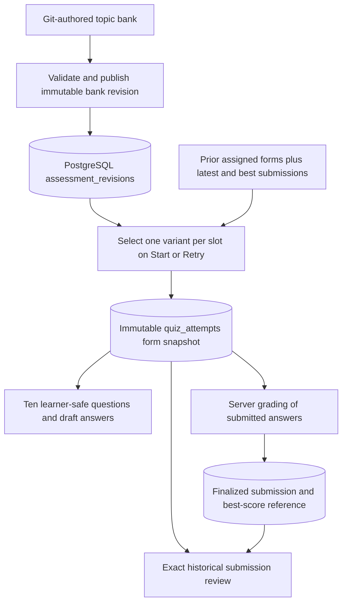

# Topic question banks and fixed quiz attempts — proposed design

Date: 2026-11-04
Status: Deferred future work. Different questions on retries is the selected direction; detailed policies remain proposed for review before implementation.
Baseline: quiz retry, best-submission review, automatic completion, and the development-learner reset fix.

## Intent and limits

Retain useful explanations after submission while making a retry assess the same topic through different examples. Every attempt remains ten questions, ten points each, passing at 60/100. Preserve automatic completion, earned unlocks, earlier-tie best retention, immutable submissions, and recovery.

A finite question bank cannot provide unlimited unseen questions. This is a beginner learning assessment, with safeguards against directly copying the latest/best answer sheet; it is not a proctored exam or proof of independent mastery. Previously viewed, downloaded, or remembered feedback cannot be revoked.

## Recommended content architecture

Keep Git-authored JSON and the existing PostgreSQL assessment_revisions publication store. Do not add a CMS, vector database, external question service, runtime AI generation, or adaptive scoring.

Each implemented quiz topic gains content/quizzes/<topicId>/bank.json. Keep activity.json as a legacy fixed-form source for historical compatibility. Publish a bank under a new assessment revision, never replace old revision bytes. Existing immutable content-hash checks remain. topics.current_revision points to the published bank revision after successful transactional publication.

A bank definition has kind multiple-choice, format quiz-bank-v1, topicId, revision, title, and exactly ten ordered slots. Each slot has a stable id, a lesson section anchor, a concrete learning objective, a beginner difficulty label, and at least three variants. A variant has a stable topic-wide id, prompt, choices, correctChoiceId, explanation, source references, and any explicit legacy question aliases. A bank revision versions the entire file; do not add independent per-question database revision management for MVP.

One slot represents one assessment requirement at a consistent level of difficulty, not necessarily one unique objective: several slots may refer to the same lesson objective. Every attempt selects one variant per slot. This gives predictable coverage and a fixed denominator without statistical calibration or difficulty-based points.

Use explicit lesson anchors and source references to verify that variants are answerable from the lesson. Variants must change the scenario, code, or reasoning task, not merely shuffle choices or restate a prompt. No variant should disclose the solution to another slot. Human content review establishes comparable scope/difficulty; metadata alone cannot prove equivalence.

Initial scope is all three implemented quiz topics:
- getting-started-with-cangjie
- installing-the-cangjie-toolchain
- identifiers

Minimum inventory: 30 variants per topic, 90 total. Existing ten questions may each supply one reviewed variant: expect at least 60 new variants. Broader roadmap topics are not silently added.

## Selection policy version 1

Topic submission owns learner-specific selection; Roadmap owns content definitions/validation. Select on the server, once, when the first attempt or a confirmed Retry is created. No selection on lesson/review reads, autosaves, refreshes, or submission.

For each ordered slot:
1. Exclude variant identities present in the current submitted Retry source and retained best submission. These may be the same submission. Exclusions use stable identities and explicit legacy aliases across revisions, not displayed question numbers or content hashes.
2. Among eligible variants prefer never assigned to this learner/topic.
3. Otherwise choose the least recently assigned eligible variant. Assignment, not submission, establishes exposure.
4. Break equal-ranking ties with server-provided random integer selection, injected in domain tests. Persist the outcome; replay must never run selection again.

Select from the current published bank. Preserve slot order and authored choice order for MVP: randomness belongs in variant selection, not incidental screen rearrangement. Choice shuffling alone does not address answer copying.

At least three variants per stable slot allow exclusion of at most two source/best variants. If old forms or bad metadata eliminate every candidate, fail the transition atomically with an unavailable state; preserve the submitted attempt and its review. Never fall back silently to the same form. The publisher must validate compatibility with all retained revisions' alias mappings.

When every eligible variant has appeared before, reuse the least recently assigned eligible variant without blocking unlimited retries. Learner information must explain that questions vary but can reappear; never promise every retry is entirely unseen. Preserve stable IDs for the same question; editing wording/revising a bank does not make an exposed variant unseen.

Legacy identities: bank variants declare legacy aliases as (assessmentRevision, questionId) pairs. Each legacy question maps to exactly one stable variant and slot; aliases cover all retained fixed quiz revisions for the topic. A legacy question whose revision was substantively different can map to a different variant, with compatibility validation checking slot exclusions. Unknown mappings block bank activation rather than guessing.

Compatibility requires a bijection for each retained legacy form: its ten questions must map to ten distinct bank slots, exactly one per slot. Slot identities and their coverage meaning remain stable across bank revisions. Variant identities cannot move between slots or be reused for unrelated questions. Publication rejects missing/duplicate slot mappings and incompatible identity changes. This preserves the maximum of two excluded variants per slot and the three-variant availability guarantee. Material changes to the assessment blueprint require a separate future design rather than weakening this constraint silently.

## Attempt form and persistence

Extend quiz_attempts with form_snapshot JSONB and form_hash text. Snapshot schema version 1 contains:
- The resolved full ten-question MultipleChoiceAssessment, including server-only answer keys and explanations, using the pinned publication revision.
- Source format (legacy-fixed or quiz-bank-v1), selection policy version, and ordered selections of slotId/variantId for bank forms.
- A canonical hash over the snapshot, using an explicitly stable serializer shared by publication and form validation.

Use the attempt snapshot as the source of truth for workspaces, draft membership validation, evaluation, current-result feedback, and historical review. No bank-wide questions or correct answers enter the public answering projection. PublicQuiz remains a ten-question projection. Return an opaque formHash with attempt identity where recovery needs to validate context; never use the hash as authorization.

Do not overload MultipleChoiceAssessment with a 30-question bank. Add a separate QuizQuestionBank type and a discriminated published-content reader; preserve coding assessment behavior. Generic assessmentFor casts must be removed from affected quiz callers so banks cannot accidentally be evaluated as fixed forms.

Create attempt + frozen form + initial draft in one transaction under the existing learner lock. Retry retains predecessor_submission_id uniqueness, expected attempt/work revision checks, and stable receipts. Another tab, lost response, duplicate click, or deadlock retry recovers the committed form. Rollback exposes no partially initialized attempt.

Make snapshot/hash/revision immutable after creation using a database guard as well as application rules; allow existing state/submission transitions. No new child question/exposure table is necessary: derive assignment history from retained attempt snapshots. Add indexing only if measured queries justify it.

Submission snapshots record attemptId and formHash alongside their existing assessment identity, answers, evaluation and score. Historical review resolves the submission's actual attempt form, checks ownership/topic/hash and recorded evaluation, and never chooses ten questions again from the bank.

## Existing learners and publication

Migration sequence:
1. Add nullable form columns.
2. Backfill every existing quiz attempt from its exact retained fixed assessment revision, preserving question/choice IDs and answers. Give it source legacy-fixed; do not map an unfinished legacy attempt onto a new bank.
3. Validate shape, revision/topic, hashes, and finalized attempt/submission links; any irrecoverable row stops migration with actionable diagnostics and full rollback. Do not copy latest content as a fallback.
4. Apply NOT NULL requirements and immutable-form guards.
5. Only after the compatible application is deployed, validate and publish new bank revisions.

Old submissions without attemptId/formHash continue resolving through their unique quiz_attempts.submission_id relation; do not rewrite immutable finalized submission bytes. New submissions must carry both identities.

Existing answering legacy attempts finish on the exact original form; subsequent Retry selects from the bank. Existing scores, best pointers, completion, unlocks, conflicts, and work revisions remain unchanged. Content corrections affect future attempts; ongoing attempts remain pinned. Missing/corrupt form data fails explicitly.

Update development reset to count/delete quiz_attempts after quiz drafts/conflicts and before submissions; retain the already applied regression fix. No additional rows are needed for bank exposure. Test fixtures must contain actual attempt forms.

## Draft and recovery integration

Validate every answer key and choice against the pinned attempt form on save, submission, and candidate conflict resolution; reject foreign questions/choices before storing a candidate. Preserve the existing conflict protocol and attempt checks. Never reinterpret an old q01 as a different variant.

Browser envelopes retain learnerId, topicId and attemptId, and gain optional formHash for backward-compatible restoration. Same-attempt legacy envelopes without formHash can attach to the authoritative form only after question/choice validation. Mismatching attempt/hash drafts remain recoverable and cannot autosave into the current attempt. Do not delete old candidate data during an IndexedDB migration. Extend pending-submit/retry recovery; do not clear uncertainty simply because the bank revision changed.

## Review access policy (recommended change)

When the current topic attempt is answering, retain best score summaries but pause delivery of historical correct answers/explanations for that topic. An empty retry counts as answering. UI offers Continue activity and explains review becomes available after submission; no Retry/abandon/reset shortcut bypasses the pending attempt.

Enforce a shared access decision server-side under the same learner lock as Retry. Apply it to best review and all transport paths that can return old per-question feedback, including replay of an old submit request. A stale submission replay still returns a confirmed receipt, score and progress with explicit feedback availability; it must not become an error or create another submission. Once the current attempt is submitted, its feedback and best review become available again.

Already delivered feedback cannot be erased from another device. Clients revalidate on focus/pageshow and remove stale feedback when they learn a retry is active; this is UX consistency, not a revocation guarantee. All learner response paths are private/no-store; no answer keys in client bundles, page payloads, serialized errors or bank endpoints.

This supersedes the previous always-available detailed best-review link and save-before-review transition. Keep current browser recovery protections; remove obsolete navigation flows/tests only after replacing their acceptance criteria. The score remains visible in the workspace. Newly confirmed failure still offers Review answers and Retry; Review answers works before starting Retry. Persistent Retry stays on the topic page.

## Alternatives considered

- Random ten questions from an unstructured pool: easy to implement but can omit important concepts or skew difficulty.
- A few preassembled complete forms: simple, but coarse reuse and duplicated content become awkward as lessons evolve.
- Selected: ten slots with reviewed variants and one immutable resolved form per attempt. Fits the current ten-question evaluator, file content, PostgreSQL transactions and review lifecycle.

## Acceptance, risks and boundaries

UC-12/13: ten pinned questions; valid selections only; no answer key before confirmed submission.
UC-14: 60/100 atomically completes/unlocks; no regression after lower retry.
UC-15: stable different-source/best selection, one successor per Retry, retained best by percentage and earlier ties.
UC-16/17: interrupted/competing drafts remain bound to one exact form.
UC-23/24: reviewed topic-aligned banks, immutable publication, historical fidelity after corrections.
New review policy applies to current API responses and UI, with explicit finite-bank/cached-feedback limits.

Content correctness and comparable difficulty are release gates; passing code tests is not evidence that 90 questions are instructionally sound. No proctoring, adaptive algorithm, grading penalty for repeats, timed tests, learner draft abandonment, new scoring scale, CMS, or AI-generated runtime questions.

Execution must update owning product/use-case/domain/architecture documents, GLOSSARY.md, content README, DESIGN.md and risk evidence after approval. This proposal does not override those documents until accepted. Preserve unrelated work when resuming implementation.
