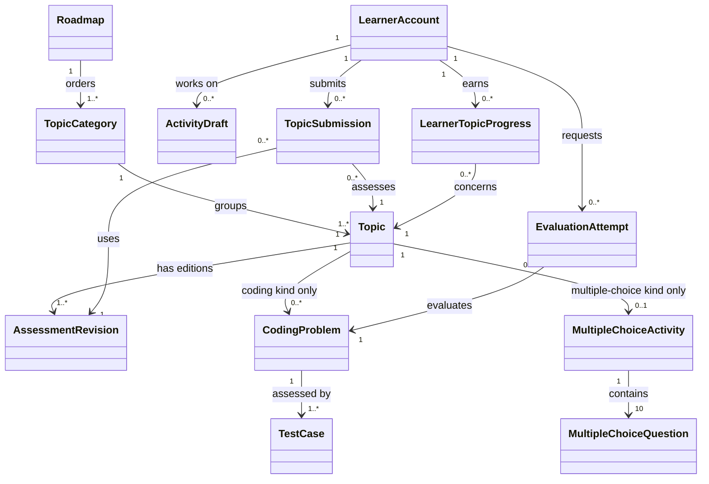
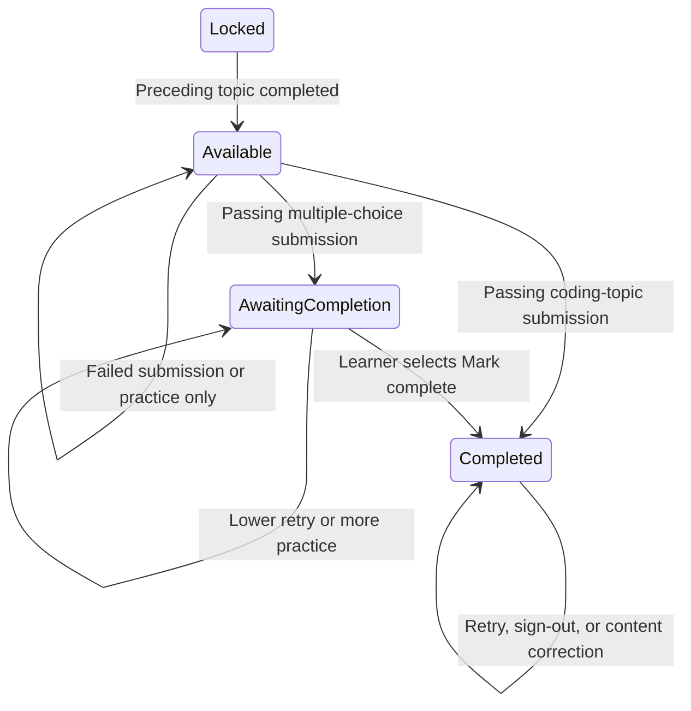

# MasterCangjie Domain and Business Model

## Purpose, authority, and scope

This model defines the concepts and rules behind MasterCangjie's operations. Read it with the [product specification](product.md), [use-case catalog](use-cases.md), and canonical [glossary](../GLOSSARY.md).

The accepted [architecture](architecture.md) places this business logic in modules and defines dependency rules. The accepted [MVP technology stack](mvp-stack.md) supplies the implementation baseline without changing this domain model.

- The product specification establishes approved product behavior.
- The use cases establish operations and their observable outcomes.
- This document identifies the entities, value objects, relationships, state transitions, invariants, and algorithms that give those operations consistent business meaning.
- The glossary defines terms; it does not contain implementation or workflow instructions.

There is no application code to reconcile with this model yet. Entity identity and rule ownership below describe the business, not database tables, classes, services, interfaces, or deployment boundaries.

**Status labels:** An **established rule** comes from the product specification, use cases, or the user's explicit product decisions during this modeling session. A **derived modeling rule** makes those rules coherent across retries, corrections, and simultaneous changes without adding a user feature. The two policies confirmed during modeling are recorded in section 10 and reflected in the source specification and use cases.

## 1. Canonical distinctions

| Distinction                                       | Meaning                                                                                                                                                                                              |
| ------------------------------------------------- | ---------------------------------------------------------------------------------------------------------------------------------------------------------------------------------------------------- |
| Learner account / Google identity / contact email | The learner account owns work and achievements. Google identity determines sign-in. An editable contact email does not determine account ownership or access.                                        |
| Topic category / topic / coding problem           | A category groups topics. A topic is the unit of progression and submitted scoring. A coding problem is one task within a coding topic.                                                              |
| Coding topic / multiple-choice topic              | A topic has one assessment type. A coding topic has one or more problems; a multiple-choice topic has exactly one ten-question activity.                                                             |
| Multiple-choice topic / "lesson-only topic"       | Use multiple-choice topic as the canonical term. The source's lesson-only wording means no coding exercises, not no assessment.                                                                      |
| Draft / evaluation attempt / topic submission     | A draft is editable work. An evaluation attempt assesses a fixed code version. A topic submission finalizes a particular set of work and its topic score.                                            |
| Individual run / batch validation                 | An individual run gives feedback only. A batch validation can award problem points and a solved achievement. Neither completes a topic by itself.                                                    |
| Current result / best topic score                 | A current result applies to current work and assessment content. A best score is historical finalized evidence and may remain valid as an achievement even when it is not reusable for current work. |
| Passed / completed / unlocked                     | Passing is an assessment outcome. Completing a multiple-choice topic additionally needs "Mark complete." Completion earns access to the next topic.                                                  |
| Learner failure / unevaluated attempt             | Incorrect code, compilation errors, and execution failures are learner outcomes. Missing evaluation due to a service failure is not a zero score.                                                    |

An unqualified "attempt" is insufficient in business rules: specify evaluation attempt or topic submission. A multiple-choice submission is a specialization of topic submission, not a second independently scored submission for the same answers.

## 2. Entities

An entity has an identity that continues through changes. Cardinalities and uniqueness here express business meaning, not storage design.

| ID    | Entity                   | Business identity and lifetime                                                  | Information and responsibilities                                                                                                                                       |
| ----- | ------------------------ | ------------------------------------------------------------------------------- | ---------------------------------------------------------------------------------------------------------------------------------------------------------------------- |
| EN-01 | Learner account          | One MasterCangjie account for a Google identity; survives sign-out and return.  | Owns profile values, active verified contacts, drafts, submissions, and progress. Contact edits do not change identity.                                                |
| EN-02 | Roadmap                  | The defined beginner learning path.                                             | Owns the explicit category and topic order. Has an initial topic and a terminal topic.                                                                                 |
| EN-03 | Topic category           | A named grouping within a roadmap.                                              | Groups topics without its own score, assessment, or completion requirement.                                                                                            |
| EN-04 | Topic                    | A learning unit that retains identity as its content is corrected.              | Has lessons, one assessment type, a prerequisite position, and a current assessment revision. Its kind is coding or multiple choice.                                   |
| EN-05 | Coding problem           | A particular task within a coding topic.                                        | Has instructions, starter code, and test cases. Test inventory determines its possible points.                                                                         |
| EN-06 | Test case                | A particular test within a coding problem, recognizable across corrections.     | Has input/setup, expected output, and visible/hidden classification in an assessment revision.                                                                         |
| EN-07 | Multiple-choice activity | The assessment belonging to a multiple-choice topic.                            | Contains exactly ten questions and has a maximum score of 100.                                                                                                         |
| EN-08 | Multiple-choice question | A particular question within an activity.                                       | Has a prompt, answer choices, and one correct choice in an assessment revision.                                                                                        |
| EN-09 | Activity draft           | The learner's working code for a problem or working selections for an activity. | Changes over time, retains save/conflict status, and identifies the current work revision. A code draft also records whether the problem has been attempted.           |
| EN-10 | Evaluation attempt       | One requested run or batch evaluation.                                          | Fixes the learner, problem, code snapshot, assessment revision, and selected test scope. Owns its evaluation status and confirmed outcomes.                            |
| EN-11 | Topic submission         | One submitted topic attempt, distinct from every retry.                         | Fixes submitted work, assessment context, possible points, contributing results, and eventual score. Includes coding submissions and multiple-choice submissions.      |
| EN-12 | Learner-topic progress   | One learner's standing in one topic.                                            | Retains best finalized score evidence, completion, and earned availability. Derives eligibility to mark complete and never reduces earned progress because of a retry. |
| EN-13 | Solved achievement       | One learner's earned all-tests-passed achievement for one coding problem.       | Refers to the qualifying batch result. It is retained even after lower retries or content corrections.                                                                 |
| EN-14 | Contact verification     | One request to verify a proposed contact email or mobile number.                | Owns the proposed contact, verification status, and whether it may replace the active verified contact.                                                                |
| EN-15 | Draft conflict           | One unresolved competition between drafts for the same learner and activity.    | Preserves candidates until the learner chooses current work. A choice does not modify submitted history or achievements.                                               |
| EN-16 | Assessment revision      | A particular published edition of one topic's assessment.                       | Identifies the exact scored problem/test inventory or question/answer definitions. Historical revisions remain distinguishable from corrected editions.                |

**Classification refinements:** Profile details belong to the learner account as values. A prerequisite is an ordered relationship, not a separate actor or required entity. Test results and question results are values within attempts or submissions; they have no independent business lifecycle. The content maintainer is an actor, not a required maintainer-account entity, because an administration interface is outside MVP scope.

**Derived modeling rule — assessment history:** A score-affecting correction creates a distinguishable assessment revision. An evaluation and finalized submission refer to the revision they used. This is the minimum business distinction needed to preserve historical scores while using corrected content for future evaluation; it does not prescribe how revisions are stored.

## 3. Value objects

A value object is defined by its contents rather than an independent business identity. Changing it produces a different value; it does not rewrite a value already used in a finalized submission.

| ID    | Value object         | Contents and constraints                                                                                                                                                                                   | Used by                                         |
| ----- | -------------------- | ---------------------------------------------------------------------------------------------------------------------------------------------------------------------------------------------------------- | ----------------------------------------------- |
| VO-01 | Google identity      | Google as provider and its confirmed account identity. Equality is account identity, not equality of editable email addresses.                                                                             | Learner account                                 |
| VO-02 | Profile details      | Username, optional bio, and optional profile photo value. No learning eligibility depends on customization.                                                                                                | Learner account                                 |
| VO-03 | Contact value        | Email or mobile kind and the proposed/active address or number. Verification belongs to EN-14; contact is not a login credential.                                                                          | Learner account, contact verification           |
| VO-04 | Code snapshot        | Exact source text and the supported Cangjie language version for an evaluated or submitted solution.                                                                                                       | Draft, evaluation attempt, coding submission    |
| VO-05 | Answer sheet         | One selection or explicit unanswered value for each of the activity's ten questions in a specified assessment revision.                                                                                    | Answer draft, multiple-choice submission        |
| VO-06 | Score                | Earned points and possible points, with possible points greater than zero and earned points between zero and the maximum. All scored units are worth ten points. A score retains its original denominator. | Batch results, submissions, best-score evidence |
| VO-07 | Passing threshold    | The exact fraction 3/5, representing 60%.                                                                                                                                                                  | Topic assessment rules                          |
| VO-08 | Assessment reference | Topic and assessment revision identifying the exact assessment definition being used.                                                                                                                      | Draft context, evaluation, submission           |
| VO-09 | Test result          | Test reference, evaluated outcome, and available output/diagnostic evidence. Permitted learner feedback depends on test visibility.                                                                        | Evaluation attempt                              |
| VO-10 | Question result      | Question reference, submitted choice/unanswered value, correctness, and earned points of zero or ten.                                                                                                      | Multiple-choice submission                      |
| VO-11 | Submission work      | The fixed code snapshots and evaluation references for a coding submission, or the fixed answer sheet for a multiple-choice submission.                                                                    | Topic submission                                |
| VO-12 | Resume location      | Roadmap, topic, activity, and optional coding-problem location appropriate to the topic kind.                                                                                                              | Learner's working progress                      |
| VO-13 | Draft candidate      | A preserved code or answer value and its work revision in a conflict. Candidate choice cannot imply an unrelated result is current.                                                                        | Draft conflict                                  |
| VO-14 | Validation window    | Learner/problem pair, last manual batch request time, cooldown of at least five seconds, and pending-evaluation status. The same pair shares its window across tabs and devices.                           | Manual batch-validation eligibility             |
| VO-15 | Feedback view        | The permitted presentation of a test result: visible output/differences and explanatory labels, or hidden-test pass/fail only. It carries no independent scoring authority.                                | Learner inspection of results                   |

The model does not invent username limits, image size/type lists, contact formatting rules, verification expiry durations, or verification retry limits. Those constraints are not specified in the product documents and must not be mistaken for established domain rules.

## 4. Relationships

| Relationship                                            | Cardinality and rule                                                                                                                                                                                                                                                   |
| ------------------------------------------------------- | ---------------------------------------------------------------------------------------------------------------------------------------------------------------------------------------------------------------------------------------------------------------------- |
| Google identity → learner account                      | Each confirmed Google identity identifies at most one learner account; each MVP learner account has one Google identity. Do not merge accounts using contact equality.                                                                                                 |
| Roadmap → category → topic                            | The MVP has one defined roadmap containing ordered categories, each grouping ordered topics. Topic progression continues across category boundaries.                                                                                                                   |
| Topic → preceding topic                                | First topic has no predecessor; every subsequent topic has exactly one immediate predecessor in the MVP roadmap. The chain is acyclic.                                                                                                                                 |
| Topic → assessment                                     | A coding topic has one or more coding problems and no multiple-choice activity. A multiple-choice topic has exactly one activity and no coding problems.                                                                                                               |
| Coding problem → tests                                 | Each problem has at least one test. Each test belongs to that problem. Tests may be visible or hidden and each contributes ten possible points.                                                                                                                        |
| Multiple-choice activity → questions → choices        | Exactly ten questions per activity. Each question has answer choices and exactly one correct choice. Selected choices must belong to their question in the assessment revision being submitted.                                                                        |
| Topic → assessment revisions                           | A topic has one current published assessment revision and may have earlier revisions. Revisions preserve the assessment kind and its relevant scoring definitions.                                                                                                     |
| Learner account → drafts                               | A learner may have working drafts for many activities. There is one selected current work value for a given activity, with competing values retained by a conflict until resolution.                                                                                   |
| Evaluation attempt → problem and revision              | One attempt evaluates one code snapshot for one problem in one assessment revision; its scope is one test or all problem tests.                                                                                                                                        |
| Topic submission → work and results                    | One submission belongs to one learner and one topic. Coding submissions use the problem/test inventory from their assessment revision and current eligible results for submitted snapshots. Multiple-choice submissions own one answer sheet and its question results. |
| Learner account × topic → progress                    | One conceptual progress record per learner/topic pair. Many submissions may contribute historical evidence; one best-score reference is retained under the score-comparison policy.                                                                                    |
| Learner account × coding problem → solved achievement | At most one retained solved achievement per learner/problem pair, supported by at least one qualifying batch validation.                                                                                                                                               |
| Learner account → contacts and verification requests   | At most one active contact email and one active mobile number, each with verification. Pending replacements coexist with current verified contacts but do not displace them until verified.                                                                            |

The table defines the exclusive assessment-type rule; the diagram's optional relationships must not be interpreted as permitting both types in one topic.

## 5. State transitions

### 5.1 Learner-topic progression

The states below are a learner-facing projection of availability, passing evidence, and completion. They do not combine submission or draft state into the same lifecycle.

- The first topic starts Available; subsequent topics start Locked.
- Available, AwaitingCompletion, and Completed all allow access to that topic.
- AwaitingCompletion means a retained finalized score of at least 60/100 exists, but the learner has not marked this multiple-choice topic complete.
- Completion earns availability of the immediate next topic. The final topic instead establishes completion of the roadmap.
- There is no retry-driven or correction-driven transition back to Locked or away from Completed.
- Onboarding uses the same rules: two multiple-choice completions followed by a passing Hello World submission. Hello World's one test allows only 0/10 or 10/10.

### 5.2 Draft, evaluation freshness, and attempted status

These are independent dimensions:

| Dimension            | Transitions and meaning                                                                                                                                                                                                                                 |
| -------------------- | ------------------------------------------------------------------------------------------------------------------------------------------------------------------------------------------------------------------------------------------------------- |
| Coding participation | Unattempted → Attempted on the first starter-code edit, run request, or validation request. Opening alone has no effect. Reverting text to starter code does not erase the fact of an attempt.                                                         |
| Work revision        | Each code edit or selection change produces a new working value. Finalized submitted values remain fixed.                                                                                                                                               |
| Evaluation freshness | No eligible batch result → Current after a confirmed complete batch for matching work and assessment revision. Current → Outdated when code or assessment scoring content changes. A later matching batch can make the current draft validated again. |
| Save status          | Saved → Unsynced after unsaved/offline edits; Unsynced → Saved once saving is confirmed. Neither state determines whether the work is correct.                                                                                                        |
| Conflict status      | Clear → Conflicted when competing work cannot be selected without losing a draft; Conflicted → Clear after learner choice. Preserve both candidates until then.                                                                                       |

Attempted status belongs to the learner's work on the problem, not to a displayed score. Deleting code or failing a run does not restore unattempted status. A service failure can leave the problem attempted and unevaluated at the same time.

### 5.3 Evaluation attempt

| From                    | Event / guard                                                            | To                      | Business effect                                                                     |
| ----------------------- | ------------------------------------------------------------------------ | ----------------------- | ----------------------------------------------------------------------------------- |
| Requested               | Work and assessment context fixed; evaluation begins                     | Evaluating              | No points or topic completion yet.                                                  |
| Requested or Evaluating | Sufficient confirmed outcomes, including a confirmed compilation failure | Evaluated               | Individual scope yields feedback only; complete batch scope yields a problem score. |
| Requested or Evaluating | Service failure or insufficient confirmed outcomes                       | Unevaluated             | No fabricated score. Keep earlier valid results and progress.                       |
| Evaluated               | Learner edits draft or content is corrected                              | Evaluated               | Attempt history stays unchanged; only its applicability to new work changes.        |
| Unevaluated             | Learner requests retry                                                   | A new Requested attempt | Keep the failed evaluation occurrence distinct from the retry.                      |

Incorrect output, compilation failure, runtime failure, and timeout are evaluated learner outcomes. They are not the Unevaluated state. A compilation failure is an explicitly scoreable zero for a batch; missing test outcomes due to a service failure are not.

Loss of connectivity creates uncertainty about the learner's knowledge of an outcome; it does not prove that evaluation failed. Recover confirmed results before claiming a score, retry success, or duplicate submission.

### 5.4 Topic submission

| From        | Event / guard                                                    | To                                             | Business effect                                                                                      |
| ----------- | ---------------------------------------------------------------- | ---------------------------------------------- | ---------------------------------------------------------------------------------------------------- |
| Prepared    | Review accepted; incomplete-work confirmation obtained if needed | Evaluating                                     | Fix submitted work and the assessment revision used for this submission.                             |
| Prepared    | Learner cancels before confirmation                              | Abandoned                                      | No finalized score or new progression. Draft remains editable.                                       |
| Evaluating  | All required evaluations available; score calculated             | Finalized                                      | Record the submission's score and passing outcome, then apply best-score and completion rules.       |
| Evaluating  | Service failure prevents required evaluation                     | Unfinalized                                    | Preserve the confirmed work and any valid component results; do not award an assumed topic score.    |
| Unfinalized | Retry confirmed work under the same assessment context           | Evaluating                                     | Reuse only matching confirmed results; do not create a second finalized outcome for the same action. |
| Finalized   | Learner edits or retries                                         | A new Prepared submission when submitted again | Previous submitted work, score, and pass/fail remain unchanged.                                      |

A changed submission work set requires a fresh review/confirmation and a new submission context. It does not mutate an already confirmed work snapshot or mix code editions into the same finalized attempt.

**Derived modeling rule — in-flight corrections:** A confirmed submission uses one fixed assessment revision. A correction published after confirmation does not change that submission's questions, tests, or denominator midway through scoring. Newly confirmed submissions use the corrected revision. This preserves consistent interpretation of both "future evaluations" and historical results. A stale result from an earlier revision cannot be reused for a newly confirmed submission.

### 5.5 Contact verification and draft conflicts

| Concept              | Transitions                     | Guard / effect                                                                                                                                         |
| -------------------- | ------------------------------- | ------------------------------------------------------------------------------------------------------------------------------------------------------ |
| Contact verification | Pending → Verified             | Ownership verification succeeds and the proposed contact is permitted for this account; activate the replacement.                                      |
| Contact verification | Pending → Pending              | A correctable unsuccessful verification does not activate the proposed contact.                                                                        |
| Contact verification | Pending → Expired or Cancelled | Retain the active verified contact and permit a fresh request.                                                                                         |
| Contact verification | Pending → Superseded           | A newer replacement request takes its place; an older request must not later overwrite the learner's newer choice. This is a derived consistency rule. |
| Draft conflict       | Open → Resolved                | Learner chooses one preserved candidate as current. Existing results become current only if they match the chosen work and assessment revision.        |

Verification rejection because a contact is already in use leaves the existing contact and sign-in identity intact. This model does not choose verification duration, delivery mechanism, or retry limits.

## 6. Business invariants and conceptual responsibility

An invariant must hold for every applicable operation, including direct links, restored work, retries, and repeated clicks. Ownership identifies the concept responsible for the decision, without prescribing a technical component.

| ID     | Invariant                                                                                                                                                                                                                                                   | Conceptual owner                                 | Use cases                         |
| ------ | ----------------------------------------------------------------------------------------------------------------------------------------------------------------------------------------------------------------------------------------------------------- | ------------------------------------------------ | --------------------------------- |
| INV-01 | Google identity determines learner account access. Contact equality never merges identities or creates another sign-in method.                                                                                                                              | Learner account                                  | UC-01–UC-03, UC-21, UC-22        |
| INV-02 | A learner's work, submissions, contacts, and achievements belong to that learner; restoration cannot substitute another account's records.                                                                                                                  | Learner account                                  | UC-01, UC-02, UC-16–UC-22        |
| INV-03 | The roadmap is an acyclic ordered path. First topic is initially available; another topic requires completion of its predecessor. Categories carry no scores.                                                                                               | Roadmap                                          | UC-04, UC-05, UC-11, UC-14, UC-23 |
| INV-04 | Each topic has exactly one assessment kind: one or more coding problems, or exactly one ten-question multiple-choice activity.                                                                                                                              | Topic                                            | UC-05, UC-12, UC-23               |
| INV-05 | Every coding problem has a nonzero test inventory. Tests, including hidden tests, are worth ten points each.                                                                                                                                                | Coding problem / assessment revision             | UC-09, UC-11, UC-23               |
| INV-06 | Every multiple-choice activity has ten questions, one correct choice per question, and 100 possible points. Correct = ten; incorrect or unanswered = zero.                                                                                                  | Multiple-choice activity                         | UC-12, UC-13, UC-23, UC-24        |
| INV-07 | Scores have positive denominators and earned points within their possible points. A topic passes exactly when earned/possible is at least 3/5.                                                                                                              | Score / topic submission                         | UC-09, UC-11, UC-13               |
| INV-08 | Individual runs award no points or solved achievement. Only a confirmed complete batch, or its defined compilation-failure outcome, can establish a problem score.                                                                                          | Evaluation attempt                               | UC-08, UC-09                      |
| INV-09 | A result can credit current work only when learner, problem, code snapshot, assessment revision, and required evaluation scope match.                                                                                                                       | Evaluation attempt / topic submission            | UC-07–UC-11, UC-16, UC-17, UC-24 |
| INV-10 | A coding submission includes every problem in its denominator. Unattempted work contributes zero after confirmation; attempted work needing evaluation cannot be silently treated as zero.                                                                  | Topic submission                                 | UC-11                             |
| INV-11 | Finalized submission work and scores are historical facts. Later edits, retries, and corrections cannot rewrite them.                                                                                                                                       | Topic submission / assessment revision           | UC-11–UC-16, UC-24               |
| INV-12 | A service failure is not a learner failure and cannot finalize a missing score as zero.                                                                                                                                                                     | Evaluation attempt / topic submission            | UC-08, UC-09, UC-11, UC-13, UC-16 |
| INV-13 | Best finalized topic percentage, solved achievement, completion, and earned availability do not decrease because of lower retries or content corrections. Compare scores by percentage and retain their original earned and possible points.                | Learner-topic progress / solved achievement      | UC-09, UC-11, UC-13–UC-18, UC-24 |
| INV-14 | A coding topic completes on a passing finalized submission. A multiple-choice topic requires passing finalized evidence and the explicit completion action. Draft answers and reading alone cannot complete a topic.                                        | Learner-topic progress                           | UC-11, UC-13, UC-14               |
| INV-15 | A retained passing multiple-choice score remains eligible for completion after a later lower retry. Completed topics need no second completion action.                                                                                                      | Learner-topic progress                           | UC-14, UC-15                      |
| INV-16 | A solved coding achievement requires an all-tests-passed batch result; it is independent of topic submission and retained after later failures.                                                                                                             | Solved achievement                               | UC-08, UC-09, UC-18               |
| INV-17 | Hidden-test inputs, expected output, actual output, differences, and revealing diagnostics never appear in learner feedback, including restored or submission results.                                                                                      | Test visibility / feedback view                  | UC-06, UC-08–UC-11, UC-16        |
| INV-18 | Visible coding output uses exact matching; whitespace and line-ending differences fail. Color alone is insufficient to explain differences.                                                                                                                 | Test comparison / feedback view                  | UC-09, UC-10, UC-23               |
| INV-19 | Manual batch validation for a learner/problem pair cannot repeat before its cooldown of at least five seconds ends or while the corresponding validation remains pending. The window is shared across tabs and devices; another problem has its own window. | Validation window                                | UC-09                             |
| INV-20 | Repeated clicks on the same pending operation cannot create multiple finalized submissions, repeated completion, or inconsistent progression.                                                                                                               | Evaluation attempt / topic submission / progress | UC-08, UC-09, UC-11, UC-13, UC-14 |
| INV-21 | Unverified contact replacements do not displace verified contacts, change Google identity, or unlock account access.                                                                                                                                        | Contact verification / learner account           | UC-21, UC-22                      |
| INV-22 | Conflicting drafts are preserved until learner choice; conflict resolution cannot assign another work revision's score to the chosen draft.                                                                                                                 | Activity draft / draft conflict                  | UC-07, UC-12, UC-16, UC-17        |
| INV-23 | Customization is optional and never a prerequisite for practice or progression.                                                                                                                                                                             | Learner account                                  | UC-19–UC-22                      |
| INV-24 | Supported exercises use Cangjie LTS 1.0.5 and console execution. No other-language, server, or UI-application exercise belongs to the MVP.                                                                                                                  | Assessment definition / code snapshot            | UC-07, UC-23                      |

## 7. Business algorithms

These are specifications of decisions and calculations, not executable code or an implementation plan.

### ALG-01: Classify coding participation and result eligibility

**Owner:** Activity draft and evaluation attempt. **Operations:** UC-06–UC-09, UC-11, UC-16, UC-17.

1. Keep a problem unattempted while the learner only views it.
2. On a starter-code edit, individual-run request, or batch-validation request, mark it attempted. Do not erase this history if the code is later reverted or evaluation fails.
3. For scoring a submitted code snapshot, look for a confirmed batch result for the same learner, problem, exact code snapshot, language version, and assessment revision.
4. An individual result is never eligible as a batch score. A failed service attempt is never eligible as a score.
5. A matching complete batch can be reused. Otherwise, attempted work needs evaluation and an unattempted problem contributes zero only under the confirmed incomplete-submission rule.

**Derived consistency:** Checking the assessment revision as well as code prevents corrected tests from being bypassed using an old result for unchanged code.

### ALG-02: Evaluate coding work and compute a problem score

**Owner:** Coding problem and evaluation attempt. **Operations:** UC-08–UC-11.

1. Fix the code snapshot, language version, assessment reference, and selected test scope when evaluation is requested.
2. If compilation is confirmed to fail, return evaluated compilation failure. An individual run awards no points; a batch earns zero out of all possible problem points.
3. Otherwise, determine each requested test's outcome. Exact output equality passes; different output, a runtime error, or a timeout fails that test. Continue other tests where possible.
4. If service failure leaves required outcomes unknown, the batch is unevaluated; do not fill unknown outcomes with failures or finalize a partial score. Confirmed learner failures remain distinct from this missing-evidence condition.
5. For a confirmed complete batch, let **P** be passed tests and **N** be all problem tests: **earned = 10 × P; possible = 10 × N**. Hidden and visible tests have equal weight.
6. An individual run returns feedback only. A batch with P = N earns or preserves the learner's solved achievement, independently of topic completion.
7. Report applicability to the evaluated work. If the learner has since edited their draft, retain the result as history without labeling the new code validated.

### ALG-03: Review and finalize a coding-topic submission

**Owner:** Topic submission. **Operations:** UC-11, using UC-09.

1. Check learner ownership and topic availability. Collect the topic's current assessment revision and the current work for every problem.
2. Show attempted, unattempted, and outdated-result work. Obtain review confirmation and explicit acknowledgment of any zero-point unattempted problems.
3. Fix that work and assessment context for this submission. Changes after confirmation belong to a new draft/submission context rather than changing this submission midway.
4. For each attempted problem, apply ALG-01. Reuse only matching confirmed batch results; evaluate other attempted snapshots through ALG-02. Skip evaluation of unattempted problems.
5. If any required evaluation remains unevaluated, leave the submission unfinalized. Preserve valid component results for an eligible retry and preserve historical scores and achievements.
6. Once every required result is confirmed, let **E = sum of earned problem points**, using zero for confirmed unattempted problems. Let **M = 10 × the count of all tests across all topic problems in this assessment revision**.
7. Finalize the score E/M and pass/fail outcome through ALG-05. Update best-score evidence and progression through ALG-06 and ALG-07.

Do not average problem percentages: the established design intentionally weights problems with more tests more heavily.

### ALG-04: Finalize a multiple-choice submission

**Owner:** Multiple-choice activity and topic submission. **Operations:** UC-12, UC-13.

1. Check topic availability and exactly ten questions in the assessment revision being submitted.
2. Check that every selected choice belongs to its question in that revision; unanswered is a valid explicit value. If corrected content makes an old draft selection invalid, return it for learner review rather than silently reinterpret the choice.
3. Show selections for review. If any are unanswered, obtain confirmation that they contribute zero.
4. Fix the confirmed answer sheet and assessment revision. Compare each selected choice with that question's correct choice.
5. Let **C** be the number of correct selections: **earned = 10 × C; possible = 100**. Wrong or unanswered questions earn zero.
6. Record the question results and finalize the topic submission only after a confirmed evaluation. Apply ALG-05 and ALG-06.
7. A passing submission enables "Mark complete" through ALG-07; it does not by itself complete a previously incomplete topic.

The submitted answer sheet is the multiple-choice attempt's historical record. It is not independently scored a second time as another topic submission.

### ALG-05: Determine passing without rounding

**Owner:** Score and topic submission. **Operations:** UC-11, UC-13.

For earned points **E** and possible points **M**, with M greater than zero:

**Pass exactly when 5 × E ≥ 3 × M.**

This is equivalent to E/M ≥ 60% without relying on a rounded displayed percentage. Examples: 90/150 passes; 80/150 fails; 60/100 passes; 50/100 fails; Hello World's 10/10 passes and 0/10 fails.

### ALG-06: Retain the best finalized topic score

**Owner:** Learner-topic progress. **Operations:** UC-11, UC-13, UC-15, UC-18, UC-24.

1. Ignore draft estimates, individual test feedback, unfinalized submissions, and unevaluated attempts for best-topic-score purposes.
2. If no finalized topic score exists, retain the first finalized score and its submission evidence, including a failing score.
3. If the new and retained scores have the same denominator, replace the best only when the new earned points are higher. Otherwise keep the retained best; never add scores across retries.
4. If denominators differ after content changes, compare normalized percentages using **new earned × old possible > old earned × new possible**. Preserve the original points and denominator of whichever result is retained. For example, 80/100 remains better than 90/150.
5. Show the new attempt's score independently. Completion, solved achievements, and earned unlocks remain intact even when the new score is lower.

Equal scores need not replace the retained qualifying evidence. Retaining an earlier passing multiple-choice submission keeps the learner eligible to mark complete.

### ALG-07: Complete a topic and advance progression

**Owner:** Learner-topic progress and roadmap. **Operations:** UC-04, UC-05, UC-11, UC-14, UC-15, UC-18.

1. If the topic is already complete, retain completion and all existing availability. Repeated completion actions do not award completion again.
2. For a coding topic, require a passing finalized submission, then mark complete.
3. For a multiple-choice topic, require retained finalized passing evidence. Until the learner selects "Mark complete," keep it awaiting completion; a failed recent retry does not invalidate earlier passing evidence.
4. After the explicit multiple-choice completion action, mark complete.
5. Make the immediate next topic available. If there is no next topic, the roadmap is complete. Initial availability of the first topic requires no preceding score.
6. Derive availability of any requested topic from initial access or retained earned availability; deny locked-topic access with prerequisite guidance. Reading, profile customization, and category completion are not additional prerequisites.

### ALG-08: Produce permitted feedback and statistics

**Owner:** Feedback values, assessment visibility, and achievement evidence. **Operations:** UC-04, UC-06, UC-08–UC-10, UC-16, UC-18.

1. Identify the work and assessment context for the confirmed result. Label outdated or unconfirmed outcomes rather than attributing them to current work.
2. For hidden tests, expose only existence and pass/fail; do not include concealed output or diagnostics in any learner view.
3. For visible tests, show permitted output and diagnostics, differentiating formatting differences from other differences. Exact matching controls correctness; colors explain the result and are accompanied by text or symbols.
4. Count completed topics from retained completion, solved coding problems from retained solved achievements, and multiple-choice results from their finalized submissions. Do not count questions as solved coding problems.
5. Show current attempt results separately from best topic scores and a next learning action. If there is no history, show an onboarding starting action rather than infer poor performance.

### ALG-09: Identify an account and activate verified contact changes

**Owner:** Learner account and contact verification. **Operations:** UC-01–UC-03, UC-19–UC-22.

1. On successful Google sign-in, identify the learner by confirmed Google identity. Return the existing learner account or create its initial account and roadmap standing. Do not select or merge an account by matching editable contact email.
2. Profile edits change profile values, not Google identity or learning progress. Sign-out ends access without deleting the learner's records. Lost Google access follows Google's recovery process.
3. For a proposed contact change, keep the candidate pending and retain the active verified value. Reject an in-use contact without replacing the old one.
4. Activate only a successfully verified candidate from a currently eligible request. An expired, cancelled, superseded, or unsuccessful request cannot replace the active contact.
5. A newer pending replacement supersedes an older pending request for the same contact kind, preventing a delayed old verification from overwriting the newer choice. This is a derived consistency rule.
6. The replacement never becomes an alternative sign-in or recovery credential. Customization remains optional.

### ALG-10: Preserve, resume, and resolve working drafts

**Owner:** Activity draft, resume location, and draft conflict. **Operations:** UC-02, UC-07, UC-12, UC-16, UC-17.

1. Associate code or selection changes and resume location with the current learner. Mark edits unsynced until their saved status is confirmed.
2. On return, recover that learner's saved work and confirmed progress. Restore offline candidates and sync when possible without overwriting competing work silently.
3. If competing versions exist, preserve both and request a learner choice. If the learner postpones the choice, keep the conflict open.
4. Once chosen, make that candidate current and re-evaluate result freshness through ALG-01. Choice of a draft does not transfer an unrelated score or rewrite a submitted answer sheet.
5. Recover confirmed outcomes after interrupted evaluation; if an outcome is unknown, keep it unconfirmed. Repeated navigation or retry must not duplicate an already finalized action.

### ALG-11: Publish an assessment correction while preserving history

**Owner:** Assessment revision and retained achievement evidence. **Operations:** UC-23, UC-24.

1. Determine whether a correction is wording-only or changes scoring interpretation, such as expected output, test inventory, correct choice, or question choices.
2. Wording-only corrections leave scores and assessment interpretation unchanged. For a scoring change, create a distinguishable corrected assessment revision with a valid test inventory or exactly ten multiple-choice questions.
3. Use the corrected revision for newly confirmed submissions and newly requested independent evaluations. In-flight confirmed submissions retain their fixed context, as defined in section 5.4.
4. Do not reinterpret an earlier submitted score using a new denominator or answer key. Do not revoke best scores, solved achievements, completion, or unlocks.
5. Notify affected learners and permit optional retries. A new submission must use eligible results for its corrected assessment revision; old results cannot bypass the corrected evaluation through reuse.
6. Apply ALG-06 to voluntary finalized retries, comparing percentages even if the assessment's possible points changed.

### ALG-12: Decide whether manual batch validation may start

**Owner:** Validation window and evaluation-attempt state. **Operations:** UC-09.

1. Require accessible learner work and no overlapping request for the same pending action.
2. For this learner and problem, require both that the corresponding validation is no longer pending and that the configured wait of at least five seconds since the prior manual batch request has elapsed. Share this window across the learner's tabs and devices. Another problem has a separate window.
3. If either guard fails, keep Validate unavailable and explain pending status or remaining cooldown.
4. On acceptance, start a distinct evaluation attempt and update the applicable request time. At five seconds, an evaluation still in progress continues to block that Validate action.

This manual Validate-button rule does not impose an artificial five-second wait between tests or between different problems evaluated as part of final submission. Submission-required work still respects matching-result, no-overlap, and duplicate-action rules.

## 8. Scenario checks

These are business examples used to challenge the model, not executable tests.

| Scenario                                                                                                   | Required outcome                                                                                                                                                                 | Governing rules                |
| ---------------------------------------------------------------------------------------------------------- | -------------------------------------------------------------------------------------------------------------------------------------------------------------------------------- | ------------------------------ |
| A learner passes all seven tests in one batch but has not submitted the topic.                             | Record 70/70 for that code and a solved problem; do not complete the topic or unlock its successor.                                                                              | INV-08, INV-14, INV-16; ALG-02 |
| A learner passes an individual test for each of seven tests, without batch validation.                     | Feedback only; no problem points or solved achievement. Final topic submission must obtain a current batch result for that attempted code.                                       | INV-08, INV-10; ALG-01, ALG-03 |
| After 70/70 validation, the learner edits the code before confirming topic submission.                     | Old result is outdated for the current work; evaluate the confirmed edited code before awarding its problem points.                                                              | INV-09; ALG-01, ALG-03         |
| A service fails after some tests return results.                                                           | Leave the required batch/submission unevaluated or unfinalized; do not fill unknown tests with zero or replace prior best scores.                                                | INV-12; ALG-02, ALG-03         |
| A coding topic has maxima 100 and 50; the learner earns 90 in the first and leaves the second unattempted. | After incomplete-work confirmation, submit 90/150, exactly 60%, and complete the topic. This is allowed by the established incomplete-submission and test-count weighting rules. | INV-07, INV-10; ALG-03, ALG-05 |
| A learner submits six correct answers, two wrong answers, and two unanswered questions.                    | Finalize 60/100 after confirmation; offer "Mark complete" without newly unlocking the next topic yet.                                                                            | INV-06, INV-14; ALG-04         |
| A multiple-choice learner earns 70/100, then retries for 40/100 before marking complete.                   | Retain 70/100 as passing evidence; "Mark complete" remains available and can unlock the next topic.                                                                              | INV-13, INV-15; ALG-06, ALG-07 |
| A learner marks Nothing complete, then signs out and later retries with a failing score.                   | Preserve roadmap completion and best score; no second completion action is required.                                                                                             | INV-13, INV-15; ALG-07, ALG-10 |
| An expected output is corrected while the learner's source text remains unchanged.                         | Preserve old finalized scores. A new submission cannot reuse the old-revision batch result as proof against corrected tests.                                                     | INV-09, INV-11, INV-13; ALG-11 |
| A correction is published after a submission has been confirmed but before it is finalized.                | Finish the confirmed submission under its fixed assessment revision; new confirmed submissions use the correction. This follows the derived in-flight consistency rule.          | Section 5.4; ALG-03, ALG-11    |
| Two tabs have different code drafts; the learner chooses one without a matching batch result.              | Keep the chosen work, preserve historical achievements, and require its own current evaluation before crediting a new submission.                                                | INV-09, INV-22; ALG-10         |
| A replacement mobile number is not verified, and an old verification request arrives later.                | Keep the active verified number; neither the pending nor superseded candidate changes sign-in or silently replaces the newer choice.                                             | INV-21; ALG-09                 |
| A learner changes their verified contact email to an address different from the Google account email.      | Change contact information only; preserve the original Google identity and learner history.                                                                                      | INV-01, INV-21; ALG-09         |
| A correction changes possible points; a learner's old best is 80/100 and the new submission earns 90/150.  | Retain 80/100 because 80% exceeds 60%. Preserve both submissions' original points and denominators.                                                                              | INV-13; ALG-06; DP-01          |
| A learner validates a problem in one tab and immediately opens the same problem in another tab.            | Share the pending status and cooldown for that learner/problem pair. A different problem has an independent window.                                                              | INV-19; ALG-12; DP-02          |

## 9. Use-case responsibility map

| Use cases                                         | Principal domain concepts                                                 | Algorithms                                 |
| ------------------------------------------------- | ------------------------------------------------------------------------- | ------------------------------------------ |
| UC-01–UC-03: Google access, sign-out, recovery   | Learner account, Google identity, retained work                           | ALG-09, ALG-10                             |
| UC-04–UC-05: Roadmap and topic access            | Roadmap, topic, learner-topic progress                                    | ALG-07, ALG-08                             |
| UC-06–UC-07: Problem inspection and editing      | Coding problem, test visibility, draft, code snapshot                     | ALG-01, ALG-08, ALG-10                     |
| UC-08–UC-10: Runs, validation, feedback          | Evaluation attempt, results, score, solved achievement, validation window | ALG-01, ALG-02, ALG-08, ALG-12             |
| UC-11: Coding-topic submission                    | Assessment revision, submission work, topic submission, progress          | ALG-01–ALG-03, ALG-05–ALG-07             |
| UC-12–UC-13: Multiple-choice work and submission | Activity, question, answer sheet, draft, topic submission                 | ALG-04–ALG-06, ALG-10                     |
| UC-14–UC-15: Completion and retry                | Finalized score evidence, learner-topic progress, earned unlocks          | ALG-06, ALG-07                             |
| UC-16–UC-17: Resume and conflict recovery        | Draft, resume location, conflict, confirmed results                       | ALG-01, ALG-10                             |
| UC-18: Statistics                                 | Retained scores, solved achievements, topic completion                    | ALG-08                                     |
| UC-19–UC-22: Profile and verified contacts       | Learner account, profile values, contact verification                     | ALG-09                                     |
| UC-23–UC-24: Content preparation and correction  | Roadmap, content entities, assessment revisions, historical evidence      | ALG-01–ALG-07 as assessment rules; ALG-11 |

## 10. Product decisions confirmed during modeling

The user confirmed these policies during this modeling session. They are established business rules and are reflected in the product specification and use-case catalog. The decision IDs allow later work to reference the rationale; they do not imply a pending approval or an architectural decision record.

### DP-01: Comparing best scores after possible points change

**Decision:** Compare best finalized topic scores by percentage, including when corrected assessments have different possible points.

Retain the original earned and possible points and keep the earlier qualifying result on a tie. Thus 80/100 remains better than 90/150. Raw-point comparison would misleadingly prefer the lower percentage just because the assessment has more possible points. Completion and unlocks stay earned.

**Affected model:** ALG-06, INV-13, historical score display, and voluntary retries after test-count changes.

### DP-02: Scope of the manual batch-validation cooldown

**Decision:** Apply the manual Validate-button cooldown per learner and coding problem, shared across that learner's tabs and devices for that problem.

The wait remains at least five seconds and the action stays blocked while its validation is pending. Switching tabs does not reset the window. A different problem has an independent window. Submission-required evaluations still follow current-work and duplicate-action rules without an artificial per-test or cross-problem five-second wait.

**Affected model:** VO-14, INV-19, ALG-12, and UC-09.

## Boundaries of this document

There are no decisions here about frameworks, API contracts, database schemas, storage, execution isolation, background processing, or deployment. Screen layout, spinners, and output colors communicate business state but do not own scoring or progression rules. No ADR is created because this work records the product's model and its necessary distinctions rather than selecting a new technical trade-off.
