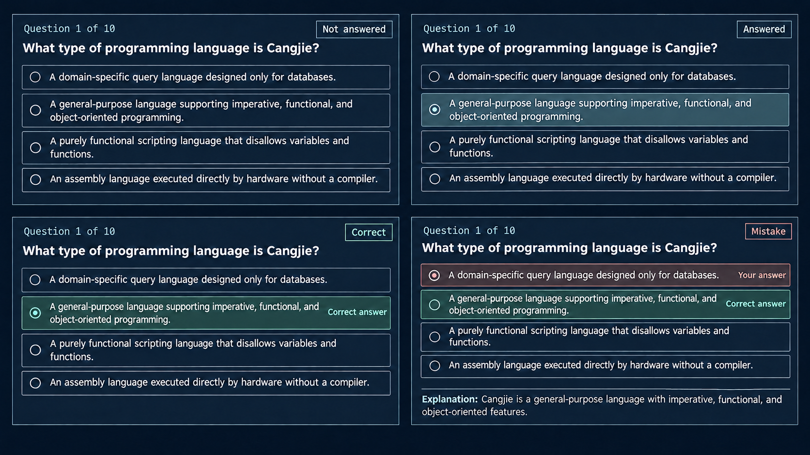

# Quiz question card design

**Status:** Accepted on 2026-11-03 as a behavioral design for the multiple-choice question card. Current visuals follow [DESIGN.md](../../../DESIGN.md). It does not change scoring, submission, or progression rules.

## Intent

Keep the learner oriented within the ten-question activity and make the difference between a saved selection and an evaluated answer unmistakable. Before submission, selection is neutral. After a confirmed result, the same card identifies the submitted choice and, when mistaken, the correct choice.

## Scope

- Preserve the current five-questions-per-page layout and native radio groups.
- Design unanswered, answered, correct, and mistaken card states, plus the confirmed-unanswered review state.
- Use the current palette, typography, and shape rules from [DESIGN.md](../../../DESIGN.md); this spec defines answer-state behavior, not a separate visual theme.
- Keep the question and answer content from the supplied screenshot. The explanation area uses the explanation returned for that question; this design does not author curriculum copy.

## Approach

Use one card that changes state in place. Its position, question prompt, and radio choices remain stable, so learners can compare their submitted answer with the right one without translating between a separate answer key and the original question. Status words and choice labels accompany color; selected radio controls always represent the learner's submitted or current choice, never the revealed answer key.

The request specifically asks to highlight the correct choice within a mistaken question, so a separate review panel or text-only explanation would not satisfy the intended comparison.

## Card states

| State | Header status | Choice treatment |
| --- | --- | --- |
| Not answered before submission | **Not answered** | No radio selected. No correctness cues. |
| Answered before submission | **Answered** | The selected radio and its row use the current blue selection treatment. Do not use success color, checks, or correctness wording. |
| Correct after confirmed submission | **Correct** | Keep the submitted radio selected and label the row **Correct answer**. Use the positive semantic treatment with the explicit status word. |
| Mistake after confirmed submission | **Mistake** | Keep the wrong submitted choice selected and label it **Your answer** with a muted error treatment. Highlight the correct choice with a muted positive treatment and **Correct answer**, but leave its radio unselected. Show the returned explanation below the choices. |
| Unanswered after confirmed submission | **Not answered** | No radio selected. Reveal and label the correct choice only in the confirmed result, then show the returned explanation. |

If a learner edits answers for a retry after a result, keep the previous result attached to the submitted choice. Show any changed draft selection as current work, not as an evaluated answer. A later submission replaces the latest result only after evaluation is confirmed.

## Data and behavior boundary

The quiz content response must continue to omit the answer key. The confirmed per-question result needs to carry `correctChoiceId` alongside `selectedChoiceId`, correctness, points, and explanation. Populate it only in the evaluation result returned after submission; do not infer it in the browser or expose it before submission. Handle older persisted result records that lack this field without mislabeling their selected choice.

## Accessibility and responsive behavior

- Keep native radio controls and a visible focus treatment on the full choice row.
- Keep status and choice labels readable without color; associate each choice group with its question prompt and result status.
- Keep choice rows at least 44 CSS pixels high and allow long prompts and choices to wrap without clipping.
- Preserve logical reading order and stack the status above the prompt when narrow widths require it.

## Visual reference

This draft illustrates state layout only; it is not production UI or evidence of implemented behavior. Apply the current visual system in [DESIGN.md](../../../DESIGN.md). The generated explanation line is illustrative; the shipped card must use the explanation supplied by reviewed quiz content.
